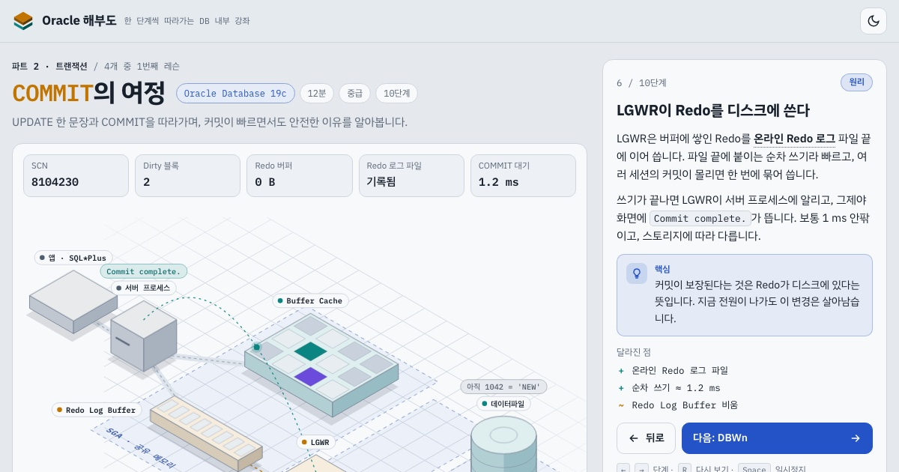

# Oracle 해부도

 **미스터오라클**의 리눅스·오라클 DBA 학습 사이트

Oracle Database 19c의 내부 구조를 한 단계씩 넘겨 보며 이해하는 인터랙티브 학습 사이트입니다.

**사이트:** https://batiappa.github.io/oracle-anatomy/



> **English:** Learn Oracle DBA work in your browser, no install. Animated "anatomy" lessons show how Oracle Database 19c and Linux work inside (STARTUP stages, COMMIT and redo, processes and memory), and a simulated Linux terminal lets you practice real DBA tasks: SQL*Plus, RMAN backup and recovery, patching, Data Guard and RAC basics. English site: https://batiappa.github.io/oracle-anatomy/en/

## 학습 순서: 해부도로 원리를 보고, 실습으로 해 보기

사이트 위쪽 탭이 학습 순서대로 놓여 있습니다.

1. **리눅스 해부도** (`linux/`) · https://batiappa.github.io/oracle-anatomy/linux/
2. **리눅스 실습** (`lab/`, 실습 1·2단계)
3. **Oracle 해부도** (루트 `index.html`)
4. **DBA 실습** (`dba/`, 실습 3~12단계)

해부도의 장면마다 아래쪽에 **이 내용 실습하기** 버튼이 있어 같은 내용을 다루는 실습 레슨으로 바로 갑니다. 반대로 실습 레슨 제목 아래의 **원리 먼저 보기**는 관련 해부도 장면으로 갑니다. 두 방향의 링크는 모두 `course.js`의 연결표 `THEORY` 한 곳에서 만들어집니다(장면 이름과 레슨 제목이 실제 화면 값과 같은지는 자동 점검으로 비교합니다).

### 리눅스 해부도 · 명령 한 줄의 여정 (12장면)

`ssh oracle@dbserver01`로 들어가 `sqlplus / as sysdba`를 칠 때 리눅스 안에서 일어나는 일을 따라갑니다. 디렉터리 트리와 OFA, 계정(UID·그룹), 셸과 PATH, 권한과 umask, 프로세스(fork·exec), 공유 메모리와 스왑, 커널 파라미터와 limits, HugePages, 디스크와 파일 시스템, 사례(/u01 가득 참, ORA-00257), 정리 순서입니다. 근거는 Oracle 19c 설치 가이드·Administrator's Reference와 리눅스 매뉴얼 페이지(man7.org), Bash 매뉴얼, 커널 문서이며 화면 아래쪽에 링크를 모아 두었습니다.

### Oracle 해부도 · 인스턴스와 데이터베이스 (10장면, `oracle/instance/`)

`STARTUP` 한 번이 NOMOUNT(파라미터 파일 → SGA·백그라운드 프로세스 → alert log), MOUNT(컨트롤 파일), OPEN(데이터 파일·온라인 리두 로그)을 거치며 무엇을 여는지 따라갑니다. 비정상 종료 뒤 인스턴스 복구, 사례 두 가지(컨트롤 파일 하나 없음 `ORA-00205`, 데이터 파일 하나 없음 `ORA-01157`), 종료 방식 네 가지를 다룹니다. 서버 이름·SID·파일 경로·SGA 크기는 DBA 실습의 dbserver02와 같습니다. 근거는 19c Concepts의 Oracle Database Instance 장, Administrator's Guide의 Starting Up and Shutting Down 장입니다.

### Oracle 해부도 · Archivelog와 RMAN (10장면, `oracle/archive/`)

온라인 리두 로그를 돌려 쓰는 방식과 NOARCHIVELOG의 한계에서 시작합니다. ARCHIVELOG로 바꾸는 순서, ARCn이 남기는 아카이브 로그, 빠른 복구 영역(FRA), RMAN 백업 세트와 컨트롤 파일 자동 백업을 차례로 따라갑니다. 사례는 두 가지로, 데이터 파일을 잃었을 때의 RESTORE와 RECOVER, FRA가 가득 찼을 때 나는 `ORA-19809`와 `ORA-00257`입니다. 근거는 19c Administrator's Guide 12장과 Backup and Recovery User's Guide입니다. 컨트롤 파일 자동 백업의 기본값은 19c 문서 두 곳의 설명이 달라서, 레슨 화면에도 그렇게 밝혀 두었습니다.

### Oracle 해부도 · 잠금과 대기 (10장면, `oracle/lock/`)

점심시간에 주문 저장이 멈춘 사례로 시작합니다. UPDATE가 고친 행마다 잡는 행 잠금(TX)과 블록 헤더의 ITL, 읽기는 Undo로 막히지 않는 이유, 같은 행을 고치려는 세션이 `enq: TX - row lock contention`으로 줄 서는 모습, 테이블 잠금(TM)이 DDL을 막는 이유를 따라갑니다. 사례는 V$SESSION의 `BLOCKING_SESSION`으로 원인 세션을 찾아 정리하는 순서와 교착 상태(`ORA-00060`)입니다. 근거는 19c Concepts의 Data Concurrency and Consistency 장, Database Reference의 대기 이벤트·잠금 이름 표, Performance Tuning Guide입니다.

### Oracle 해부도 · Undo와 읽기 일관성 (10장면, `oracle/undo/`)

두 시간 돌던 월말 보고서가 `ORA-01555`로 끝난 사례로 시작합니다. UPDATE가 고치기 전 값을 Undo에 남기는 것, ROLLBACK, 쿼리가 시작 시점(SCN)의 데이터를 보는 문장 단위 읽기 일관성, Undo로 CR 사본을 만드는 과정, 커밋 뒤 Undo를 남기는 `UNDO_RETENTION`(기본 900초, 하한값)을 따라갑니다. 사례는 V$UNDOSTAT의 `TUNED_UNDORETENTION`으로 원인을 확인하고 보존 기간과 공간을 늘리는 순서입니다. 고정 크기 Undo에서 UNDO_RETENTION이 무시되는지는 Administrator's Guide와 Database Reference(19.7 RU부터)가 달라 화면에 함께 적었습니다.

### Oracle 해부도 · 체크포인트 (10장면, `oracle/checkpoint/`)

야간 배치의 DML이 모두 `log file switch (checkpoint incomplete)`에서 멈춘 사례로 시작합니다. 커밋은 리두만 쓰고 데이터 블록은 더티 버퍼로 남는 것, 가장 오래된 더티 버퍼로 정해지는 체크포인트 위치, CKPT(기록)와 DBWn(쓰기)의 역할, 로그 스위치와 V$LOG의 ACTIVE·INACTIVE를 따라갑니다. 사례는 로그 전환 횟수 확인, 리두 로그 크기·개수 늘리기, `FAST_START_MTTR_TARGET`입니다.

### Oracle 해부도 · SGA·PGA와 백그라운드 프로세스 (10장면, `oracle/memory/`)

SGA를 8G에서 12G로 늘렸더니 인스턴스가 뜨지 않은 사례로 시작합니다. 모든 프로세스가 함께 쓰는 SGA(버퍼 캐시, 공유 풀, 리두 로그 버퍼 등)와 프로세스마다 하나인 PGA(개인 SQL 영역, 정렬·해시 작업 영역), 접속마다 생기는 서버 프로세스, 필수 백그라운드 프로세스(PMON, LREG, SMON, DBWn, LGWR, CKPT, MMON 등), 메모리 관리 방식(AMM, ASMM)과 `PGA_AGGREGATE_LIMIT`을 따라갑니다. 사례는 `USE_LARGE_PAGES=ONLY`에서 HugePages가 모자라 시작에 실패한 것을 `vm.nr_hugepages` 6144로 고치는 순서입니다.

### Oracle 해부도 · 파싱과 Shared Pool (10장면, `oracle/parse/`)

새 버전 배포 뒤 CPU가 90%가 되고 공유 풀에 숫자만 다른 SQL이 수천 개 쌓인 사례로 시작합니다. SQL 처리의 네 단계, 파싱의 세 가지 확인(문법, 의미, 공유 풀), 라이브러리 캐시와 데이터 사전 캐시, 하드 파스와 소프트 파스, 공유 SQL 영역과 개인 SQL 영역, 글자 하나까지 같아야 공유되는 규칙, 바인드 변수를 따라갑니다. 사례는 `parse count (hard)`로 확인하고 `CURSOR_SHARING=FORCE`를 임시로 쓰며 앱을 바인드 변수로 고치는 순서입니다.

### Oracle 해부도 · 옵티마이저와 실행계획 (10장면, `oracle/optimizer/`)

대량 이관 뒤 인덱스가 있는데도 `TABLE ACCESS FULL`을 고른 사례로 시작합니다. 옵티마이저의 변환기·추정기·계획 생성기, 선택도·카디널리티·비용, 데이터 사전의 옵티마이저 통계, 전체 스캔과 인덱스 접근을 고르는 기준, `DBMS_XPLAN.DISPLAY_CURSOR`로 실행 계획 읽는 법을 따라갑니다. 사례는 이관 전에 모은 통계(800행)를 `DBMS_STATS.GATHER_TABLE_STATS`로 다시 모아 `INDEX RANGE SCAN`으로 바뀌는 순서입니다.

### Oracle 해부도 · B-tree 인덱스 (10장면, `oracle/btree/`)

`ship_date`에 인덱스가 있는데 `ship_date IS NULL` 조회가 테이블 전체를 읽는 사례로 시작합니다. 루트·브랜치·리프 블록, 균형 트리와 높이(BLEVEL + 1), 리프의 키와 rowid, 인덱스 고유 스캔과 범위 스캔, 클러스터링 팩터, 인덱스가 DML에 주는 비용을 따라갑니다. 사례는 단일 열 B-tree 인덱스에 NULL이 저장되지 않는다는 문서 규칙에서 출발해 복합 인덱스로 해결하는 순서이며, 해결 방법은 그 규칙에서 이끌어 낸 것임을 화면에 밝혔습니다.

### Oracle 해부도 · Data Guard (10장면, `oracle/dataguard/`)

새벽에 주 DB 서버(dbserver02)의 저장 장치가 망가진 사례로 시작합니다. 블록 단위 복제본인 물리 대기 DB, redo 전송과 RFS·대기 리두 로그, MRP0의 Redo Apply와 실시간 적용, SYNC·ASYNC와 세 보호 모드, transport lag·apply lag, 브로커(DGMGRL), 스위치오버와 페일오버를 따라갑니다. 사례는 지연을 확인한 뒤 `FAILOVER TO orclstby`(완전 페일오버)로 대기 DB를 주 DB로 올리고, 수리한 옛 주 DB를 `REINSTATE DATABASE`로 되살리는 순서입니다.

### Oracle 해부도 · RAC (10장면, `oracle/rac/`)

새벽에 racnode2가 재부팅된 뒤 정산 배치가 두 배 느려진 사례(DBA 실습 레슨 103과 같은 장애)로 시작합니다. DB 하나를 여러 인스턴스가 여는 구조(인스턴스별 SGA·redo thread·Undo), SCAN과 서비스(preferred·available), Cache Fusion과 GCS·GES·GRD, LMS·LMD·LMON, gc 대기, 노드 장애 때 VIP와 서비스가 옮겨 가는 과정을 따라갑니다. 사례는 자동으로 돌아오지 않은 서비스를 `srvctl relocate service`로 되돌리는 순서입니다.

## 무엇을 보여 주나

첫 레슨 **COMMIT의 여정**은 `UPDATE` 한 문장과 `COMMIT` 한 번을 10단계로 따라갑니다. 주요 내용은 다음과 같습니다.

1. 블록을 Buffer Cache로 읽기
2. 이전 값을 Undo에 기록
3. 변경 벡터를 Redo Log Buffer에 기록하고 블록이 dirty가 됨
4. `COMMIT`: SCN 할당, 커밋 레코드, LGWR 호출, `log file sync` 대기
5. LGWR의 온라인 Redo 로그 순차 쓰기
6. DBWn의 지연 쓰기와 Write-Ahead Logging
7. 사례: 커밋 직후 정전과 SMON 인스턴스 복구
8. 사례: 한 건마다 커밋하는 배치와 `log file sync`

단계마다 오른쪽 설명, 왼쪽 다이어그램, 위쪽 지표(SCN, dirty 블록, Redo 버퍼, 대기 시간), 아래쪽 SQL*Plus·alert.log 화면이 함께 바뀝니다.

## 리눅스 실습실 (`lab/`)

**주소:** https://batiappa.github.io/oracle-anatomy/lab/

실무 경험이 없는 신입 DBA가 Oracle Linux 8 서버를 흉내 낸 브라우저 터미널에 직접 명령을 입력하며 익히는 실습 과정입니다. 리눅스 실습실(1·2단계)과 DBA 실습(3~12단계)은 하나의 "실습 과정"으로 이어집니다. 두 화면 위쪽에 같은 단계 메뉴가 있어 1~12단계의 진행률(완료한 레슨 수)을 한눈에 보고 어느 단계로든 바로 갈 수 있습니다. 단계 메뉴는 두 화면이 함께 쓰는 `course.js`가 그리고, 진행률은 각 화면이 브라우저에 저장한 값(`ohb:lab:done`, `ohb:dba:done`)을 함께 읽어 계산합니다.

### 1단계 · 리눅스 기초 (Oracle 19c가 이미 돌아가는 dbserver01, oracle 계정)

| 레슨 | 내용 | 주요 명령 |
|---|---|---|
| 1 | DB 서버에 처음 접속하기 | `ssh`, `whoami`, `hostname`, `cat /etc/os-release`, `uname -r` |
| 2 | 오라클이 사는 디렉터리 둘러보기(OFA) | `pwd`, `ls -la`, `cd`, `mkdir`, `cp` |
| 3 | alert log에서 오류 찾기(ADR) | `tail -n`, `grep -n`, `tail -f`, Ctrl+C |
| 4 | vi로 작업 일지 쓰기 | `vi`, `i`, `o`, `Esc`, `:wq`, `:q!` |
| 5 | oracle 계정과 권한 | `id`, `chmod`, `su -`, `chown`, `exit` |
| 6 | 프로세스로 DB 상태 확인 | `ps -ef \| grep pmon`, `top`, `kill` |
| 7 | 디스크가 찼다는 연락 대응 | `df -h`, `du -sh`, `ls -lh`, `rm`, `free -m` |
| 8 | 환경 변수 설정 | `echo $ORACLE_HOME`, `vi ~/.bash_profile`, `source`, `which sqlplus` |
| 9 | 졸업 미션: 아침 점검 | 배운 명령 종합 |

### 2단계 · 오라클을 위한 리눅스 준비 (오라클이 없는 새 서버 dbserver02, root 계정)

설치 가이드(Oracle Database Installation Guide for Linux 19c)의 순서를 따릅니다. 주소의 레슨 번호는 `#lesson-10`부터 `#lesson-18`입니다.

| 레슨 | 내용 | 주요 명령 |
|---|---|---|
| 1 | 설치 전 서버 점검(OS, 커널, 아키텍처, RAM·스왑, /tmp, 공간, 호스트 이름) | `uname -r`, `grep MemTotal /proc/meminfo`, `df -h`, `ping -c 1` |
| 2 | preinstall RPM으로 설치 준비 | `rpm -q`, `dnf install oracle-database-preinstall-19c`, `id oracle` |
| 3 | 커널 파라미터 확인 | `cat /etc/sysctl.d/...`, `sysctl kernel.sem`, `sysctl -a`, `sysctl --system` |
| 4 | 자원 제한(limits) 확인 | `su - oracle`, `ulimit -Sn`, `ulimit -Hn` |
| 5 | HugePages 설정과 THP 확인 | `grep Huge /proc/meminfo`, `vm.nr_hugepages`, `cat /sys/kernel/mm/transparent_hugepage/enabled` |
| 6 | 디스크 I/O 스케줄러와 클럭 소스 | `lsblk`, `cat /sys/block/sdb/queue/scheduler` |
| 7 | 직무 분리 그룹과 grid 사용자 | `groupadd -g`, `useradd -u -g -G`, `usermod`, `passwd` |
| 8 | 설치 디렉터리와 경로 규칙(심볼릭 링크, oraInst.loc) | `ls -ld`, `mkdir -p`, `chown -R`, `chmod -R 775` |
| 9 | 졸업 미션: 손으로 준비한 서버의 빠진 곳 5개 찾아 고치기 | 배운 명령 종합 |

- 실제 리눅스가 아니라 JavaScript로 만든 가상 파일 시스템과 셸입니다. 서버 비용이 없고, 무엇을 지워도 "레슨 다시 시작"으로 되돌릴 수 있습니다.
- 기준 값은 공식 자료에서 가져왔습니다. `/etc/os-release`는 `oraclelinux-release-8.10` 패키지, `.bash_profile`과 `.bashrc`는 `bash-4.4.20-6.el8_10` 패키지의 `/etc/skel`, oracle 사용자와 그룹 ID(54321 등)와 커널 파라미터는 `oracle-database-preinstall-19c-1.0-4.el8` 패키지에서 그대로 옮겼습니다. 디렉터리 구조는 Oracle 19c 설치 가이드의 OFA 예시, alert log 위치는 Administrator's Guide의 ADR 설명을 따릅니다. 레슨마다 화면에 출처 링크가 있습니다.
- 2단계의 패키지 버전은 yum.oracle.com의 Oracle Linux 8 저장소 목록에서, preinstall RPM이 바꾸는 값(커널 파라미터, 자원 제한, 사용자·그룹, THP와 `numa=off` 부팅 옵션, 기록 파일 위치)은 `oracle-database-preinstall-19c-1.0-4.el8` 패키지를 풀어 그 안의 `.param` 파일과 verify 스크립트에서 확인했습니다. 설치 전 커널 기본값, 기본 자원 제한, 디스크 구성은 예시입니다. ORAchk와 설치 프로그램(runInstaller, fixup 스크립트)은 흉내 내지 않고 해설로만 다룹니다.
- 열 간격, 날짜, 크기, PID, IP, 서버 이름 같은 값은 설명용 예시입니다.

## DBA 실습 (`dba/`)

**주소:** https://batiappa.github.io/oracle-anatomy/dba/

리눅스 실습실 다음 단계입니다. 2단계에서 준비한 dbserver02에 Oracle Database 19c를 설치하고 ORCL 데이터베이스를 만든 상황에서, 가상 터미널로 SQL*Plus, lsnrctl, RMAN, orapwd, dgmgrl, 그리고 RAC의 crsctl·srvctl·olsnodes를 직접 다룹니다. 주소의 레슨 번호는 3단계가 `#lesson-21`부터 `#lesson-29`, 4단계가 `#lesson-91`부터 `#lesson-96`, 5단계가 `#lesson-31`부터 `#lesson-36`, 6단계가 `#lesson-41`부터 `#lesson-43`, 7단계가 `#lesson-51`부터 `#lesson-53`, 8단계가 `#lesson-61`부터 `#lesson-63`, 9단계가 `#lesson-71`부터 `#lesson-73`, 10단계가 `#lesson-81`부터 `#lesson-83`, 11단계가 `#lesson-101`부터 `#lesson-108`, 12단계가 `#lesson-111`부터 `#lesson-113`입니다. 단계 번호는 배우는 순서이고 레슨 번호는 만든 순서라서 둘이 어긋납니다.

### 3단계 · 오라클 19c 기본 운영 (dbserver02, oracle 계정)

| 레슨 | 내용 | 주요 명령 |
|---|---|---|
| 1 | SQL*Plus로 처음 접속하기(OS 인증) | `sqlplus / as sysdba`, `show user`, `v$instance`, `v$database`, `set linesize`, `col ... format` |
| 2 | DB 내리고 단계별로 올리기 | `shutdown immediate`, `startup nomount`, `alter database mount/open`, `host ps -ef` |
| 3 | 리스너 살리고 원격 접속 확인하기 | `lsnrctl status/start/services`, `alter system register`, `sqlplus app/...@ORCL` |
| 4 | 꽉 찬 테이블스페이스에 공간 늘리기(ORA-1653) | `dba_data_files`, `dba_free_space`, `alter tablespace ... add datafile` |
| 5 | 조회 전용 사용자 만들고 권한 주기 | `create user`, `grant create session`, `grant select on`, `dba_tab_privs` |
| 6 | 지워진 암호 파일 다시 만들기 | `orapwd file=... format=12.2`, `v$pwfile_users`, `grant sysbackup` |
| 7 | 락을 잡고 있는 세션 정리하기 | `v$session.blocking_session`, `v$process.spid`, `alter system kill session 'sid,serial#'` |
| 8 | 아카이브 모드로 바꾸고 첫 RMAN 백업 받기 | `archive log list`, `alter database archivelog`, `rman target /`, `backup database plus archivelog` |
| 9 | 졸업 미션: 재부팅 뒤 아침 점검 | 배운 명령 종합, `alter user ... account unlock` |

### 4단계 · SQL 기초 (dbserver02, 실습용 STUDY 계정)

SQL 문법을 처음 배우는 단계입니다. 실습용 STUDY 스키마에 부서(DEPT) 4개와 사원(EMP) 10명이 들어 있습니다.

| 레슨 | 내용 | 주요 명령 |
|---|---|---|
| 1 | SELECT로 테이블 읽기 | `sqlplus study/...`, `user_tables`, `desc`, `select * from`, 계산 열과 별칭, `distinct` |
| 2 | WHERE로 고르고 ORDER BY로 정렬하기 | `where`, `and`, `like`, `between`, `= null`과 `is null` 비교, `order by ... desc` |
| 3 | 함수와 GROUP BY로 집계하기 | `count(*)`와 `count(열)`, `sum`, `round(avg())`, `to_char(날짜)`, `group by`, ORA-00937, `having` |
| 4 | 조인과 서브쿼리 | `join ... on`, 쉼표와 WHERE 조인, `left join`(부서 없는 사원, 사원 없는 부서), 스칼라 서브쿼리, `in (서브쿼리)` |
| 5 | INSERT·UPDATE·DELETE와 COMMIT·ROLLBACK | `insert`, `update`, `delete`, `commit`, `rollback`, ORA-00001, ORA-01400 |
| 6 | 졸업 미션: 테이블 만들고 보고서 뽑기 | `create table`(PRIMARY KEY, FOREIGN KEY, NOT NULL), `user_constraints`, ORA-02291, `spool` 파일 |

- 근거: SQL Language Reference 19c(SELECT, 조인, 하위 질의, 집계 함수, NULL, INSERT·UPDATE·DELETE, COMMIT, CREATE TABLE과 제약 조건), Database Concepts 19c(트랜잭션, 제약 조건 위반 예시), SQL*Plus User's Guide 19c(SET FEEDBACK, EXITCOMMIT).
- 확인하지 못한 것: "1 row created." 같은 DML 피드백 문구, ORA-02291, 02292, 01407, 12899, 01722, 01438, 00937, 00979, 01427의 화면 문구 전체. 터미널에 ⓘ 줄로 알립니다. 사원·부서 데이터는 설명용 예시입니다.

### 5단계 · 장애 대응과 복구 (dbserver02, oracle 계정, ARCHIVELOG + 백업이 있는 ORCL)

| 레슨 | 내용 | 주요 명령 |
|---|---|---|
| 1 | 지워진 데이터 파일 하나 되살리기(DB는 연 채로, ORA-01116) | `validate database`, `alter tablespace ... offline immediate`, `restore/recover tablespace`, `online` |
| 2 | SYSTEM 데이터 파일을 잃은 DB 살리기(ORA-01157) | `startup`, `v$recover_file`, MOUNT 상태에서 `restore/recover datafile 1`, `alter database open` |
| 3 | 컨트롤 파일 사본 하나를 잃었을 때(ORA-00205) | alert log의 ORA-00202, `show parameter control_files`, `shutdown abort`, 살아남은 사본 `cp` |
| 4 | 빠른 복구 영역이 가득 차 DB가 멈췄을 때(ORA-00257, ORA-19809) | `v$recovery_file_dest`, `alter system set db_recovery_file_dest_size`, `delete noprompt obsolete` |
| 5 | 실수로 지운 테이블 되살리기 | `show recyclebin`, `flashback table ... to before drop`, `dba_recyclebin` |
| 6 | 졸업 미션: 장애가 겹친 아침 | 데이터 파일 복구 + Flashback Drop + 장애 보고서 |

- 복구 순서(OFFLINE → RESTORE → RECOVER → ONLINE, MOUNT 상태 복구), 컨트롤 파일 사본 복사, ORA-19809의 해결책, FLASHBACK TABLE 문법은 Backup and Recovery User's Guide 19c, Administrator's Guide 19c, SQL Language Reference 19c와 19c 오류 도움말에서 확인했습니다. FRA가 가득 찼을 때의 대응 절은 18c 문서에서만 찾았고, 그렇다고 화면에 적었습니다.

### 6단계 · 고급 복구

| 레슨 | 내용 | 주요 명령 |
|---|---|---|
| 1 | 실수(TRUNCATE) 직전 시각으로 DB 되돌리기 | `export NLS_DATE_FORMAT`, `run { set until time ...; restore database; recover database; }`, `alter database open resetlogs` |
| 2 | 컨트롤 파일을 모두 잃었을 때 | `restore controlfile from autobackup`, `alter database mount`, `recover database`, `open resetlogs` |
| 3 | 졸업 미션: 지워진 테이블과 빈 휴지통 | Flashback Drop 실패 확인 → 시점 복구 → 새 백업 → 보고서 |

### 7단계 · 성능 점검

| 레슨 | 내용 | 주요 명령 |
|---|---|---|
| 1 | 지금 무엇을 기다리는지 보기 | `v$session`(EVENT, WAIT_CLASS), `v$sql`, `v$system_event`, `v$sys_time_model` |
| 2 | AWR 보고서로 지난밤 배치 들여다보기 | `dba_hist_snapshot`, `dbms_workload_repository.create_snapshot`, `@$ORACLE_HOME/rdbms/admin/awrrpt.sql` |
| 3 | 졸업 미션: 주문 저장이 멈춘 아침 | `enq: TX - row lock contention`, `blocking_session`, `alter system kill session` |

- 6단계 절차는 Backup and Recovery User's Guide 19c(DBPITR, 백업 컨트롤 파일로 복구)와 Backup and Recovery Reference 19c(RESTORE, RECOVER, untilClause)를, 7단계는 Performance Tuning Guide 19c와 Database Reference 19c 부록 C(대기 이벤트)를 따랐습니다. awrrpt.sql의 질문 문구는 18c와 26ai 판 문서에서 원문을 확인했습니다(19c 해당 절은 확인한 범위 밖). AWR은 Oracle Diagnostics Pack 라이선스가 필요하다는 문서의 안내도 레슨에 적었습니다.

### 8단계 · 패치 (OPatch와 분기별 RU)

| 레슨 | 내용 | 주요 명령 |
|---|---|---|
| 1 | 패치 전 점검: 지금 버전과 받아 둔 RU 확인 | `opatch lspatches`, `opatch lsinventory -detail -oh $ORACLE_HOME > 파일`, `dba_registry_sqlpatch`, `unzip`, `opatch version`, OPatch 교체(패치 6880880), `opatch prereq CheckConflictAgainstOHWithDetail -ph ./` |
| 2 | 정기점검: RU 적용하고 datapatch 돌리기 | `shutdown immediate`, `lsnrctl stop`, `opatch apply`, `startup`, `./datapatch -sanity_checks`, `./datapatch -verbose`, `dba_registry_sqlpatch` |
| 3 | 졸업 미션: RU 되돌리기 | `opatch rollback -id`, `./datapatch -verbose`, ROLLBACK 기록 확인 |

- 근거: Oracle Database Patch Maintenance(19c and Later)의 RU 주기(1·4·7·10월 셋째 화요일)와 out-of-place 권장, Upgrade Guide 19c의 버전 번호 설명, Database Reference 19c의 DBA_REGISTRY_SQLPATCH, OPatch User's Guide의 lsinventory·lspatches·rollback 형식. 단일 인스턴스 패치 절차(사전 lsinventory 저장, 충돌 검사, DB와 리스너 종료, opatch apply, datapatch -sanity_checks와 -verbose, SUCCESS 확인)는 19c판 문서에서 같은 장을 찾지 못해 26ai판 "Single-Instance Maintenance with OPatch"를 인용했고, 화면에도 그렇게 적었습니다.
- OPatch와 datapatch의 화면 예시는 공식 문서에서 찾지 못했습니다. 실습 화면은 줄인 흉내이고 ⓘ 줄로 알립니다. 패치 번호(38291812), RU 버전(19.29), OPatch 버전 번호(12.2.0.1.17, 12.2.0.1.47)는 설명용 예시 값입니다.

### 9단계 · SQL 튜닝 입문 (실행 계획과 인덱스)

| 레슨 | 내용 | 주요 명령 |
|---|---|---|
| 1 | 느린 SQL의 실행 계획 읽기 | `explain plan for ...`, `select * from table(dbms_xplan.display)`, `user_ind_columns`, `dbms_xplan.display_cursor('sql_id')` |
| 2 | 조건을 고쳐 인덱스 타게 하기 | `to_char(order_date,'YYYYMM')` → `order_date >= date '...' and order_date < date '...'`, TABLE ACCESS FULL → INDEX RANGE SCAN |
| 3 | 졸업 미션: 고객별 주문 조회가 느린 아침 | `v$sql`, `dba_tab_statistics`(STALE_STATS), `dbms_stats.gather_table_stats`, `create index ... online` |

- 근거: SQL Tuning Guide 19c(실행 계획 만들기와 보기, 접근 경로, 인덱스를 쓰지 못하는 이유 표, 통계 수집 예), PL/SQL Packages and Types Reference 19c의 DBMS_XPLAN(DISPLAY, DISPLAY_CURSOR 인수), SQL Language Reference 19c의 EXPLAIN PLAN과 CREATE INDEX(ONLINE, 함수 기반 인덱스 예). "Explained."와 DISPLAY_CURSOR의 `SQL_ID  ..., child number 0` 머리줄, 계획 표의 열 제목은 문서 예시와 같습니다.
- 실습의 옵티마이저는 "인덱스 첫 열에 함수 없이 = 나 범위 조건이 있으면 인덱스를 쓴다"는 단순한 규칙만 흉내 냅니다. Rows, Bytes, Cost, Time과 Plan hash value는 설명용 예시입니다.

### 10단계 · Data Guard 기초 (주 DB와 물리 대기 DB)

dbserver02의 주 DB(DB_UNIQUE_NAME orcl)와 dbserver03의 물리 대기 DB(orclstby)가 Data Guard 브로커 구성(orcl_dg, MaxPerformance)으로 묶여 있는 상황입니다.

| 레슨 | 내용 | 주요 명령 |
|---|---|---|
| 1 | 주 DB와 대기 DB 상태 점검 | `dgmgrl /`, `show configuration`, `show database orclstby`, `sqlplus sys/...@ORCLSTBY as sysdba`, `v$database`(DATABASE_ROLE, DB_UNIQUE_NAME), `v$dataguard_stats`, `v$dataguard_process` |
| 2 | 적용이 멈춘 대기 DB | `show database`의 Intended State APPLY-OFF와 Apply Lag, `edit database orclstby set state='APPLY-ON'` |
| 3 | 졸업 미션: 계획된 전환(스위치오버) | `validate database orclstby`, `switchover to orclstby`, 두 서버의 `v$database` 역할 확인 |

- 근거: Data Guard Broker 19c의 DGMGRL 예시(SHOW CONFIGURATION, SHOW DATABASE, EDIT DATABASE SET STATE, SWITCHOVER 출력)와 명령 설명(CONNECT, VALIDATE DATABASE), Data Guard Concepts and Administration 19c의 Redo Apply와 역할 전환(스위치오버는 데이터 손실이 없음, 브로커 사용 권장), Database Reference 19c의 V$DATAGUARD_STATS(주 DB에서는 행이 없음)와 V$DATAGUARD_PROCESS.
- 적용 지연이 시간 단위일 때의 표시, 주 DB 쪽 SHOW DATABASE, V$DATAGUARD_PROCESS의 프로세스 이름과 PID는 문서 예시로 확인하지 못했습니다. 실습 화면에 ⓘ 줄로 알립니다. 적용을 다시 켜면 실습에서는 지연이 바로 0이 됩니다.

### 11단계 · RAC 기초 (2노드 클러스터 racnode1·racnode2)

결제 DB(PAYDB)를 두 서버의 인스턴스 PAYDB1·PAYDB2가 함께 여는 Oracle RAC 19c 상황입니다. Grid 홈은 `/u01/app/19.0.0/grid`, 서비스는 `pay_oltp`(두 인스턴스 모두 preferred)와 `pay_batch`(PAYDB2 preferred, PAYDB1 available)입니다.

| 레슨 | 내용 | 주요 명령 |
|---|---|---|
| 1 | RAC 클러스터 상태 점검 | `which srvctl crsctl`, `olsnodes -n -s`, `crsctl check cluster -all`, `crsctl stat res -t`, `srvctl status/config database -db paydb`, `gv$instance`와 `v$instance` 비교 |
| 2 | 서비스를 옮기고 인스턴스 하나 내리기 | `srvctl status/config service`, `srvctl relocate service -db paydb -service pay_batch -oldinst PAYDB2 -newinst PAYDB1`, `gv$session` 집계, `srvctl stop instance -db paydb -instance PAYDB2 -stopoption immediate` |
| 3 | 졸업 미션: 노드 장애 뒤 서비스 되돌리기 | `srvctl status service`, `gv$session`의 gc 대기 이벤트, 서비스를 PAYDB2로 되돌리고 확인, 보고서 |

- 근거: Real Application Clusters Administration and Deployment Guide 19c(SRVCTL 명령, 서비스의 preferred·available, GV$ 뷰, Cache Fusion 대기 이벤트), Clusterware Administration and Deployment Guide 19c(CRSCTL, OLSNODES, crsctl check cluster -all 예시), Database Reference 19c(GV$ 뷰와 INST_ID, gc 대기 이벤트). `crsctl stat res -t` 표의 구조는 21c Private Cloud Appliance 문서의 예시로 확인했습니다.
- 확인하지 못한 것: srvctl status·config 줄의 정확한 문구, crsctl 표의 열 간격과 서비스 자원 이름, check crs·activeversion 문구, 실패할 때의 PRC·PRK 오류 번호(지어내지 않고 ⓘ 안내로 바꿨습니다). 실습은 서비스가 원래 인스턴스로 자동으로 돌아가지 않는다는 문서 설명을 따릅니다. 이름, IP, 세션 수와 시각은 설명용 예시입니다.

### 12단계 · OS 원인 장애 (디스크, 메모리, 시계)

DB는 멀쩡한데 리눅스 쪽 문제로 오라클이 멈추는 세 가지 상황입니다. SQL보다 df, du, dmesg, free, systemctl, chronyc 같은 OS 명령으로 원인을 찾습니다.

| 레슨 | 내용 | 주요 명령 |
|---|---|---|
| 1 | 디스크가 가득 차 아무도 접속하지 못할 때 | `ORA-09925`(Linux 오류 28) 확인, `df -h`, `du -sh`, `ls -lh`, 큰 export 덤프를 `/u02`로 `mv`, 다시 접속 |
| 2 | 메모리가 모자라 리눅스가 오라클을 죽였을 때 | `ps -ef \| grep pmon`, alert log, `dmesg -T`의 OOM killer 기록, `id oracle`, `free -m`, `grep -i huge /proc/meminfo`, `startup` |
| 3 | RAC 노드의 시계가 어긋났을 때 | Clusterware alert log의 `CRS-2409`, `crsctl check ctss`(CRS-4700 Observer), `systemctl status/start/enable chronyd`, `chronyc tracking` |

- 근거: Oracle 오류 도움말(ORA-09925, CRS-2409, CRS-4700), Administrator's Reference 19c for Linux and UNIX(HugePages는 스왑되지 않음, THP 끄기, AMM과 HugePages는 함께 못 씀), Grid Infrastructure Installation Guide 19c(chrony가 있으면 CTSS observer 모드, CTSS deprecated, `cluvfy comp clocksync`), Clusterware Administration and Deployment Guide 19c(Clusterware alert log 위치), 리눅스 커널 소스와 문서(ENOSPC 28, OOM 메시지 형식, oom_score_adj), chrony 4.5 문서(tracking 항목, makestep 경고, maxslewrate 기본값), My Oracle Support 문서 제목(Linux-x86_64 Error: 28 줄 형식).
- 확인하지 못한 것: Oracle Linux 8 커널의 정확한 OOM 문구(현재 커널 소스 형식을 썼습니다), OOM으로 인스턴스가 죽을 때 alert log 문구(넣지 않았습니다), systemctl status 화면 모양, crsctl check ctss 출력 전체, alert log의 [OCTSSD(...)] 표시. 터미널에 ⓘ 줄과 레슨 끝 설명으로 알립니다.

- SQL*Plus 안에는 실습에 필요한 만큼의 작은 SQL 엔진(SELECT의 조인·외부 조인·하위 질의, WHERE, GROUP BY, HAVING, ORDER BY, 집계 함수, 4단계 STUDY 스키마의 INSERT·UPDATE·DELETE·COMMIT·ROLLBACK, 몇 가지 DDL)과 SQL*Plus 형식의 출력(LINESIZE, PAGESIZE, FEEDBACK, COLUMN FORMAT)이 들어 있습니다.
- 절차와 해설은 Oracle Database 19c 공식 문서를 기준으로 했고, 레슨마다 근거 링크를 붙였습니다. 공식 문서 예시로 확인한 출력과 확인하지 못한 출력은 페이지 아래쪽에 나누어 적었고, 확인하지 못한 출력은 터미널에도 ⓘ 줄로 알려 줍니다.
- 진행 상황은 리눅스 실습실과 따로 브라우저에 저장됩니다(`ohb:dba:done`).

## 힌트의 실무 메모 (`tips.js`)

- 힌트를 열면 명령 아래에 주석(리눅스·RMAN은 `#`, SQL은 `--`)으로 그 명령의 옵션을 찾아보는 방법과 현장에서 자주 덧붙이는 옵션이 나옵니다. 예: `set linesize 200` 아래에 `HELP SET`, `SHOW ALL`, `grep ORA- ...` 아래에 `grep --help`, `man grep`, `> 파일`, `| tee 파일`.
- 주석에 나온 찾아보기 명령은 가상 터미널에서도 동작합니다.
  - 리눅스: `man 명령`, `명령 --help`, `help 내장명령`(cd, echo, export, umask, source), `tee [-a]`, `sort [-n|-h|-r]`
  - SQL*Plus: `HELP INDEX`, `HELP 명령`, `SHOW ALL`, `SPOOL 파일 [CREATE|REPLACE|APPEND]`, `SPOOL OFF`, `SPOOL`(상태)
  - RMAN: `rman target / log 파일 [append]` (결과를 화면 대신 파일에 기록)
  - lsnrctl: `lsnrctl help`
- man, --help, HELP 화면은 실습용 한국어 요약입니다. SQL*Plus HELP의 형식 줄(`SET LIN[ESIZE] {80 | n | WINDOW}`, `SPO[OL] [file_name[.ext] [CRE[ATE] | REP[LACE] | APP[END]] | OFF | OUT]` 등)은 SQL*Plus User's Guide 19c의 표기를 옮겼습니다. RMAN LOG 동작(출력은 파일로, 입력은 화면에)은 Backup and Recovery Reference 19c의 RMAN 명령 설명을 따랐습니다. SHOW ALL 줄 형식, SPOOL 상태 문구와 오류 문구는 확인하지 못해 터미널에 ⓘ 줄로 알려 줍니다.

## 실습 세션 자동 저장 (`session.js`, `sw.js`)

- 리눅스 실습실과 DBA 실습은 지금 하던 레슨을 브라우저(localStorage `ohb:lab:sess`, `ohb:dba:sess`)에 자동 저장합니다. 새로고침해도 터미널 화면, 명령 기록, 가상 서버 상태, vi 편집 중인 내용, 할 일 진행, 열어 둔 힌트가 그대로 돌아옵니다.
- 화면을 통째로 저장하지 않고, 레슨을 시작한 시각과 난수 씨앗, 그 뒤의 입력(Enter, Tab, Ctrl+C, vi 키)을 시각과 함께 적어 둡니다. 다시 열면 같은 시각·같은 난수로 레슨을 만들고 입력을 그때 시각대로 다시 실행합니다.
- **강력 새로고침을 하면 저장한 세션을 지우고 처음부터 시작합니다.** 단축키는 Ctrl+F5, Shift+F5, Ctrl+Shift+R, 맥 크롬·파이어폭스는 Cmd+Shift+R, 맥 사파리는 Option+Cmd+R입니다. 두 가지 신호로 알아봅니다. (1) 페이지가 받은 강력 새로고침 단축키를 기억해 두었다가 다음 로드에서 확인합니다. (2) 요청을 가로채지 않는 빈 서비스 워커(`sw.js`)를 두고 "새로고침인데 서비스 워커가 페이지를 맡지 않았다"를 봅니다. 툴바의 Shift+클릭 새로고침은 (2)로만 잡힙니다. 자동 시험은 Chromium에서만 했습니다. 휴대폰처럼 강력 새로고침이 없는 곳에서는 "레슨 다시 시작"을 누르면 됩니다.
- 레슨 완료 표시(`ohb:*:done`)는 강력 새로고침으로 지우지 않습니다.

## 구현

- **외부 라이브러리 없이** HTML, CSS, JavaScript로 동작합니다. 두 해부도(루트, `linux/`)는 같은 엔진 `anatomy.js`와 스타일 `anatomy.css`를 쓰고, 페이지에는 레슨 데이터만 있습니다.
- **아이소메트릭 다이어그램은 SVG로 그립니다.** 격자 좌표를 화면 좌표로 바꾸는 변환, 상자와 원통 그리기, 연결선을 따라 움직이는 흐름 애니메이션(`requestAnimationFrame`, `getPointAtLength`)으로 구성됩니다.
- **레슨은 데이터입니다.** `LESSON` 객체에 영역, 구성 요소, 연결선, 단계별 상태(보일 요소, 흐름, 태그, 지표, 콘솔)를 적으면 엔진이 그립니다. 새 레슨은 엔진을 고치지 않고 데이터만 추가합니다.
- 단계별 주소(`#step-6`), 키보드 조작(←/→, Space, R), 다크 모드, 모바일 화면, 움직임 줄이기 설정을 지원합니다.

## 방문 측정과 검색 노출

- `stats.js`는 [GoatCounter](https://www.goatcounter.com/)(쿠키를 쓰지 않는 방문 통계)를 붙이는 파일입니다. 파일 안 `CODE`가 비어 있으면 아무것도 하지 않고, `batiappa.github.io`에서 열 때만 셉니다. 계정의 사이트 코드를 `CODE`에 넣으면 켜집니다.
- `sitemap.xml`은 한국어·영어 페이지와 서로의 언어 대체 주소(`hreflang`)를 적은 목록입니다. 이 사이트는 도메인 하위 경로(`/oracle-anatomy/`)라 `robots.txt`로 알릴 수 없으므로, Google Search Console에 URL 접두어 속성을 만들고 이 주소를 직접 제출합니다.
- 저장소 단위 조회 수는 GitHub의 Insights → Traffic에서 봅니다(최근 14일만 보관).

## 로컬에서 보기

`index.html`을 브라우저로 열면 됩니다. 또는:

```bash
python3 -m http.server 8000
```

## 로드맵

- Oracle 해부도: 계획한 12개 레슨(파트 1~4) 완성
- DBA 실습 다음 후보: Data Guard 페일오버와 복원(REINSTATE), RMAN으로 대기 DB 만들기
- Oracle Database 19c 실습 환경에서 수치를 측정해 예시 값을 실측값으로 교체하고, 검증 스크립트와 결과를 저장소에 기록

## 영어판(English)과 다른 언어

- 영어판은 `en/` 폴더에 있습니다(예: `en/`, `en/lab/`, `en/dba/`). 머리글의 "한국어 / English" 단추로 오가고, 고른 언어는 브라우저에 기억됩니다(`lang.js`). 진행 기록과 자동 저장 세션은 두 언어판이 함께 씁니다.
- 한국어 원본만 고칩니다. `en/`은 `tools/i18n/i18n.py`가 원본과 번역 사전(`tools/i18n/en/*.json`)으로 만들어 내는 파일이라 직접 고치지 않습니다. 터미널 명령과 출력은 원래 영어라 그대로 둡니다.
- 레슨을 고치거나 더한 뒤에는 다음 순서로 영어판을 맞춥니다.

```bash
python3 tools/i18n/i18n.py todo en    # 새로 번역할 문장을 tools/i18n/en/_todo/에 내보냄
# 사전(tools/i18n/en/*.json)에 "한국어 원문": "번역" 을 채움
python3 tools/i18n/i18n.py check en   # 빠진 번역 0인지 확인
python3 tools/i18n/i18n.py build en   # en/ 다시 만들기
```

- 일본어 같은 다른 언어를 붙일 때는 `tools/i18n/ja/` 사전을 만들고, `i18n.py`의 `LANGS`와 `lang.js`의 `LANGS`에 한 줄씩 더하면 됩니다.

## 만든 사람

미스터오라클(김영조, 현업 때 쓰던 필명) · [ambrokim@gmail.com](mailto:ambrokim@gmail.com)

## 참고

- 설명은 Oracle Database 19c 기준입니다. 현재 화면의 SCN, 블록 번호, 시간 수치는 설명용 예시 값입니다.
- 이 프로젝트는 Oracle Corporation 및 그 계열사와 관련이 없으며, 후원이나 승인을 받지 않았습니다. Oracle과 Java는 Oracle 및 그 계열사의 등록상표입니다. ‘미스터오라클’은 만든 사람의 필명이며 Oracle 제품이나 서비스 이름이 아닙니다.
